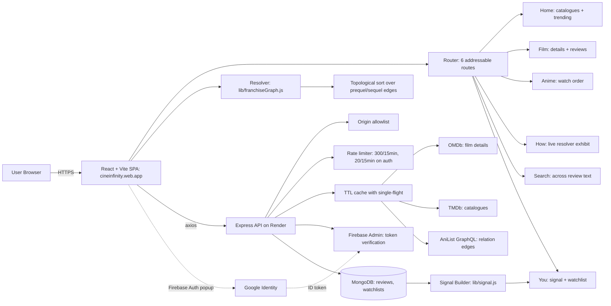

# Architecture: CineInfinity

**Author**: Kavya Aggarwal

This document details the engineering architecture of CineInfinity: how a franchise is resolved into a watch order, how a viewer's ratings are read back as a profile, which upstream APIs are cached and why, and where the system degrades rather than fails.

---

## 1. High-Level System Blueprint

---

## 2. Layered Software Architecture

### Presentation Layer (`movie-review-frontend/src/`)
React 18 with Vite. Six routes, each a real address: a film is linkable, the back button works, and a resolved watch order can be sent to someone. Global state is two contexts (`AuthContext`, `WatchlistContext`); everything else is a hook (`useMovieSearch`, `useReviews`, `useCatalogue`, `useSignal`) or a prop. An `ErrorBoundary` wraps the shell so one failing panel cannot blank the page.

This layer was previously a single 452-line `App.js` holding routing, auth, search and review state together. Decomposing it surfaced six live defects, including a debounce that never debounced and stale search responses overwriting fresh ones.

### Domain Logic Layer (`src/lib/`)
Pure, dependency-free, and directly tested.

- `franchiseGraph.js` collects a franchise and produces three orderings.
- `similarity.js` scores tag overlap for recommendations, normalised by the smaller tag profile.
- `sortFilms.js` sorts and filters catalogue rows, treating unrated and undated titles as absent rather than zero.
- `graphLayout.js` assigns graph nodes to columns by longest-path depth for the `/how` exhibit.

### API Layer (`movie-review-backend/routes/`)
Express 5. Literal routes are declared before parameterised ones, and `test/routeOrder.test.js` asserts that invariant across both routers: `/omdb/search` once sat after `/omdb/:title` and was unreachable, so OMDb was being asked for a film called "search".

### Service Layer (`movie-review-backend/lib/`)
- `cache.js` is a TTL cache with single-flight: concurrent misses on one key share a single upstream call, and failures are never cached.
- `signal.js` computes the rating profile described in §4.
- `serviceAccount.js` loads the Firebase credential from the environment or a local file, accepting base64 because dashboards mangle newlines in PEM keys.
- `anilistQueries.js` holds the only GraphQL documents the server will forward.

### Persistence Layer (`models/`)
Mongoose over MongoDB. Reviews carry a denormalised copy of the film's title, year and poster, so a feed of twenty reviews costs zero upstream calls against a quota the cache exists to protect. Watchlists are unique on `(userId, movieId)` in the database, so a double press is absorbed rather than racing.

---

## 3. The Resolver

The feature the rest of the application is arranged around.

AniList publishes typed relation edges between entries. `collectFranchise` walks that graph breadth-first from a seed, bounded by depth and entry caps so a sprawling series cannot exhaust the request budget. `watchOrders` then produces three orderings:

- **release**, sorted by date, which is what every other site shows
- **story**, a topological sort over prequel and sequel edges
- **essential**, story order with recaps, shorts and promotional entries classified out

Three properties make this correct rather than approximately correct. Cycles are detected and broken rather than hung on. Entries whose prequels were never fetched are marked as boundaries so they are not mistaken for roots. Ties are broken by classification rank before date, so a side story lands beside the entry it belongs to.

**Edge direction is normalised before use.** AniList states a `PREQUEL` edge from an entry *to* the thing preceding it, which is the reverse of "watch this first". Used as given, the graph renders newest-first with every arrow pointing backwards in time.

The canonical test is Monogatari: *Kizumonogatari* is a prequel released seven years after the series it precedes. The resolver places it first.

---

## 4. Your Signal

The analytics layer, and the only feature that requires an account.

`lib/signal.js` builds a profile from everything a user has rated: the distribution across all ten points, the standard deviation, the decades they review, and how far their scores sit from everyone else's on the films both have rated.

Three decisions keep it honest rather than decorative.

1. **The crowd excludes the user.** Comparing someone against an average they are the sole contributor to returns a difference of exactly zero by construction.
2. **Small samples are declared, not interpreted.** Below three ratings the verdict says so; below three *shared* films the bias is not shown at all, because one coincidence in the same type as a real finding reads as a real finding.
3. **Unrated is not zero.** Both upstream APIs return `0` for "nobody has rated this", which is not a score anyone gave.

---

## 5. Resilience

The server binds its port unconditionally and degrades per subsystem.

Both the Firebase credential and the Mongo connection previously called `process.exit` on failure. On a host that redeploys per commit, one unset variable became a crash loop: a failed deploy and a notification on every push, taking down public routes that needed neither.

| Subsystem | Missing or unreachable | Effect |
|---|---|---|
| `FIREBASE_SERVICE_ACCOUNT` | Lazy init records the fault | Authenticated routes return 503; browsing, search and the resolver are unaffected |
| `MONGO_URI` | Logged, not fatal; mongoose retries | Reviews unavailable; a late database recovers without a redeploy |
| `CORS_ORIGINS` | Falls back to a default allowlist | Localhost permitted outside production |

`GET /health` returns 200 when every subsystem is up and 503 with the specific fault named otherwise, so a bad deploy is one request to diagnose rather than a scroll through logs.

**AniList is proxied, not called from the browser.** It rate-limits per client IP; from the browser the client is the visitor, and the refusal arrives as an opaque CORS error because a 429 carries no CORS headers. Proxied, it is one budget, cached for an hour across all viewers, and only three named operations are forwarded so the server is not an open GraphQL relay.

---

## 6. Quality Assurance

**218 automated tests**: 124 frontend (Vitest), 94 backend (`node:test`).

The backend suite includes the review API end to end, real HTTP against real handlers and real Mongoose on an in-memory MongoDB, with only Firebase stubbed. It requires no keys and nothing provisioned.

Where a test guards something subtle, it was verified by reintroducing the defect and confirming that test, and only that test, fails. That applies to ownership isolation on reviews, the token revocation check, the guard against a stale search response overwriting a newer one, the route ordering above, the refusal to report a bias from one shared film, and the longest-path graph layout.

CI runs both suites, the production build and a dependency audit on every push. The audit has already caught a router version inside a published advisory range on its first run after that dependency was added.

---

## 7. Deployment

| Component | Host | Notes |
|---|---|---|
| Frontend | Firebase Hosting | `cineinfinity.web.app`; hashed assets cached one year, `index.html` uncached |
| Backend | Render | Free tier sleeps when idle; first request after a quiet period takes roughly 90 seconds |
| Database | MongoDB Atlas | |
| Auth | Firebase Authentication | Google provider; authorised domains must include every host that serves the app |

A Firebase site ID cannot be renamed, so the original host remains and forwards every path to the canonical one, preserving links already shared.
